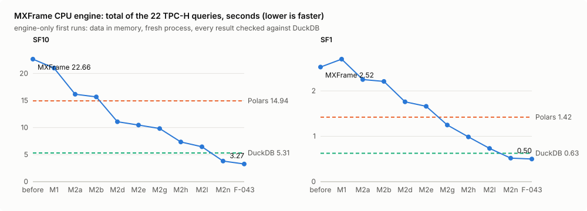

# 🚀 MXFrame

> **GPU-accelerated DataFrames — Python ergonomics, Mojo AOT kernels.**

MXFrame is a DataFrame query engine that pairs a Polars-style Python API with pre-compiled Mojo AOT kernels. The current GPU build is validated on **NVIDIA**; AMD and Apple Silicon validation remain on the roadmap.

[](docs/benchmarks.md)
[](pyproject.toml)
[](pyproject.toml)
[](LICENSE)

---

## ✨ Why MXFrame?

| | pandas | Polars | cuDF (RAPIDS) | **MXFrame** |
|---|---|---|---|---|
| GPU support | ❌ | ❌ | ✅ NVIDIA | ✅ **NVIDIA validated** |
| Compiled kernels | ❌ | ✅ Rust | ✅ CUDA | ✅ **Mojo AOT** |
| Install complexity | pip | pip | CUDA + RAPIDS stack | **pip or pixi** |
| TPC-H coverage | reference | ✅ | ✅ | ✅ **22/22** |
| Portable kernel design | ❌ | CPU | CUDA | ✅ NVIDIA today; AMD/Apple planned |

MXFrame uses a portable Mojo kernel architecture rather than CUDA-specific source. Kernels compile once to shared libraries and dispatch directly at runtime.

### What changed in v0.4, v0.5 and v0.6

- **v0.6.0 — native Mojo CPU executor:** each query stage (scan, filter, joins, group-by, DISTINCT, top-N, COUNT(DISTINCT)) runs in one ahead-of-time compiled Mojo call over Arrow memory. Engine-only TPC-H SF10 totals 3.15 s, against DuckDB 5.08 s and Polars 14.40 s (without Q21, DuckDB is lower: 2.27 s against 2.41 s). See [How the CPU engine got fast](#-how-the-cpu-engine-got-fast-v060-2026-10-14) and the [v0.6.0 release notes](RELEASE_NOTES_0.6.0.md).

- **v0.4.0 — correct string/composite joins:** shared dictionaries assign identical dense IDs across both join sides; mixed composite keys and SQL null semantics are preserved.
- **v0.5.0 — native GPU UTF-8 predicates:** `startswith`, literal `contains`, string equality/inequality, and packed non-null literal `isin` operate directly on Arrow offsets and byte buffers.
- **v0.5.0 — weak-query fusion:** dedicated compact GPU paths remove expanded intermediates from Q4, Q6, Q13, and Q21.
- **v0.5.0 — bounded benchmarking and visualization:** every query/engine runs in an isolated process; Q4, Q6, Q12, Q13, Q14, and Q21 have step-by-step kernel visualizations.

See [v0.5.0 release notes](RELEASE_NOTES_0.5.0.md) for measured gains, limitations, and the parity roadmap.

---

## 🧠 How `device="auto"` works

Give MXFrame a CPU and a GPU and `compute(device="auto")` decides where each query runs
from costs it measures on your machine. First scans run on the CPU while the table's
columns copy to the GPU in the background; after that, queries split their rows so the
GPU and every CPU core work at the same time. On TPC-H SF10 Q1 the split finishes the
aggregation in 25 ms, against 57 ms on the CPU alone and 39 ms on the GPU alone.

On the final user-felt TPC-H run, `auto` is within 10% of the better of `cpu` and `gpu` on
22/22 queries at SF10, and on 21/22 at SF1 (median of 4 runs; single runs 17–21). Each query ran in a fresh process from Parquet on disk with
no warm-up, and every result matched DuckDB. On the five SF10 queries where the GPU wins from a
cold start (Q5, Q7, Q9, Q18, Q21), `auto` stays within 5% of it. At SF1, where CUDA start-up
would cost more than the query, it stays on the CPU.

➡️ **[Read how it works](docs/auto-mode.md)** · [visual version](https://htmlpreview.github.io/?https://github.com/abhisheksreesaila/mxframe/blob/main/docs/auto-mode.html)

---

## ⚡ Quick Start

```sh
# 1. Install pixi (Modular's package manager)
curl -fsSL https://pixi.sh/install.sh | bash

# 2. Clone and set up
git clone https://github.com/abhisheksreesaila/mxframe
cd mxframe
pixi install

# 3. Verify GPU is working
pixi run python3 scripts/_check_gpu.py
```

```python
import pyarrow as pa
from mxframe import LazyFrame, Scan, col, lit

data = pa.table({
    "dept":   pa.array(["eng", "eng", "mkt", "mkt", "eng"]),
    "salary": pa.array([120.0, 95.0, 80.0, 110.0, 130.0], pa.float32()),
    "age":    pa.array([32, 28, 35, 29, 40], pa.int32()),
})

result = (
    LazyFrame(Scan(data))
    .filter(col("age") > lit(28))
    .groupby("dept")
    .agg(
        col("salary").sum().alias("total_salary"),
        col("age").count().alias("headcount"),
    )
    .sort(col("total_salary"), descending=True)
    .compute(device="gpu")   # or "cpu"
)
print(result.to_pandas())
```

```
  dept  total_salary  headcount
0  eng         345.0          3
1  mkt         110.0          1
```

**GPU memory.** Importing `mxframe.aot_kernels` sets `MODULAR_DEVICE_CONTEXT_MEMORY_MANAGER_SIZE_PERCENT=25` unless you have set it yourself. Left at its default, the Mojo runtime reserves about 90% of the free GPU memory the first time a kernel allocates a scratch buffer, which starves mxframe's own allocations at TPC-H SF10 and every other process on the GPU. The variable is process-wide: other MAX / Mojo users in the same Python process get the 25% pool too. Set it to a larger value before importing mxframe if a kernel needs more scratch than a quarter of the GPU.

---

## 📈 How the CPU engine got fast (v0.6.0, 2026-10-14)

Over three days of work, the engine went from Python glue around kernels to Mojo running each
query stage in one native call. Python plans the query. Mojo runs the filters, joins, group-bys,
DISTINCT and gathers directly on Arrow memory.

**How we measure (the headline): engine-only, first run.**
- Loading data is staging. Each engine first reads the query's columns from Parquet into its own
  in-memory form, outside the clock. The official TPC-H power test, the H2O db-benchmark and
  ClickBench do the same.
- The clock covers the query and its materialized result only.
- Each query runs in a fresh process, and only the **first** run counts: no warm-up and no
  reused results.
- Every result is checked against DuckDB.



| total of 22 queries, engine-only | MXFrame (CPU) | Polars | DuckDB |
|---|---:|---:|---:|
| SF10 | **3.15 s** | 14.40 s | 5.08 s |
| SF1 | **0.47 s** | 1.31 s | 0.63 s |
| SF10, rows shuffled | **4.97 s** | 15.06 s | 5.55 s |
| SF1, rows shuffled | **0.61 s** | 1.41 s | 0.66 s |

**Where it stands, honestly:**

- **Much of MXFrame's lead over DuckDB comes from Q21.**
  - Q21 at SF10 takes 0.74 s for MXFrame against 2.81 s for DuckDB on stored rows, and 1.34 s
    against 2.77 s on shuffled rows.
  - **Leaving Q21 out, DuckDB's SF10 total is lower:**
    - stored rows: 2.27 s against MXFrame's 2.41 s;
    - shuffled rows: 2.79 s against 3.63 s.
  - At SF1 the two are even: 0.39 s each on stored rows, and DuckDB 0.42 s against 0.46 s
    shuffled.
- **Against DuckDB, per query:**
  - DuckDB is faster on 12 of the 22 TPC-H queries at SF10.
  - The largest gaps are joins: Q3, Q5, Q8, Q11, Q12, Q17 and Q22 run at 0.44–0.69x DuckDB's speed.
  - MXFrame is faster on the other 10. It leads most on Q1, Q13 and Q21 (2.1–3.8x).
- **Against Polars:**
  - TPC-H: MXFrame is faster on 20 of the 21 verified queries at SF10 (Polars is 3% faster on Q16;
    Polars' Q1 result is wrong) and on 11 of 22 at SF1.
  - Random queries: faster at SF10 (43 of 50, 3.8x geometric mean) and on shuffled SF1 (97 of
    99, 3.1x).
- **MXFrame's results equal DuckDB's** on every query: the 22 TPC-H queries (stock and shuffled)
  and the 250 random queries.

**Beyond the 22 queries.** Every number above also has to hold on queries and data the engine was
not tuned for.
- A seeded generator writes random queries over the TPC-H tables. They cover filters, group-bys,
  joins, top-N, DISTINCT, count-distinct and HAVING.
- Each query runs in all three engines, on the stored row order and on shuffled rows, and every
  result is checked against DuckDB.

Reports:
- random queries: [SF1](docs/bench/random-sf1-m2s.md) ·
  [SF1 shuffled](docs/bench/random-sf1-shuffled-m2s.md) · [SF10](docs/bench/random-sf10-m2s.md);
- TPC-H: [stored rows](docs/bench/m2s-engine.md) ·
  [shuffled rows](docs/bench/m2s-engine-shuffled.md).

MXFrame's speed against DuckDB on random queries, for all three runs. Each figure is the geometric
mean of DuckDB time / MXFrame time; above 1x means MXFrame is faster. The last column shows the
same SF10 figure before and after the F-046 work (F-044 run → this run):

| query shape | SF1 | SF1, rows shuffled | SF10 | SF10, before → after F-046 |
|---|---:|---:|---:|---:|
| filter + group-by | 1.12x | 1.72x | 1.84x | 1.86 → 1.84x |
| global aggregate | 0.68x | 1.16x | 1.26x | 1.33 → 1.26x |
| joins | 0.88x | 1.13x | 0.96x | 0.64 → 0.96x |
| top-N rows | 0.58x | 0.98x | 0.90x | 0.41 → 0.90x |
| SELECT DISTINCT | 0.57x | 0.99x | 0.62x | 0.43 → 0.62x |
| COUNT(DISTINCT) | 0.84x | 1.11x | 0.89x | 0.31 → 0.89x |
| **all** | **0.83x** | **1.21x** | **1.09x** | **0.75 → 1.09x** |

- MXFrame is now ahead overall at SF10 and on shuffled SF1.
- It leads on filter + group-by in every run. On shuffled SF1 it leads on every shape except
  SELECT DISTINCT and top-N, which are about even.
- At SF1 and SF10 it trails on SELECT DISTINCT, COUNT(DISTINCT), top-N and joins, and at SF1 on
  global aggregates.
- SF1 queries take a few milliseconds each, so the SF1 columns move with machine load.

Each optimization is explained in **[docs/optimizations.md](docs/optimizations.md)** with a
diagram, its before/after numbers, and the Mojo feature it relies on (or a plain statement when it
is ordinary engineering). Caveats:

- **Numbers come from `docs/bench/m2s-engine*.md` and `random-*-m2s.md`, all on one build.**
  - Shuffled TPC-H and the three random suites ran 01:21–01:50 on 2026-10-14. They started after
    the load average had stayed under 2 for 5 minutes.
  - The first stored-rows TPC-H pass overlapped a scheduled snapshot cleanup, and every engine
    came out slower. It was discarded.
  - The stored-rows run shown here was rerun at 02:05, after 5 minutes under load 1. The only
    processes sampled during it besides the benchmark were a browser at about a quarter of one
    core and, in the last sample, one short process at 98% of one core.
- **DuckDB is timed without its pyarrow import.**
  - DuckDB imports pyarrow inside its first `.arrow()` call (about 70 ms per process).
  - That import is now staging, like MXFrame's own import.
  - Earlier versions of this page counted it, which overstated MXFrame's lead over DuckDB.
- **MXFrame warms its kernels during staging.** `import mxframe` warms the kernel libraries in the
  background, and that finishes during the untimed load.
- **Polars' Q1 at SF10** takes 2.7 s and differs from DuckDB's result, so it is not counted as a
  win. Leaving Q1 out, the SF10 totals are MXFrame 3.09 s, Polars 11.68 s and DuckDB 4.94 s.
- **Import time and the Parquet read are reported separately.**
  - The earlier scoreboards below include them, and predate this work.
  - MXFrame still reads Parquet through PyArrow (F-021).

## 📊 Earlier scoreboards (2026-10-12, before the Mojo executor)

**User-felt (secondary).** These include staging: each engine runs each query in a fresh
process. The data starts as Parquet on disk, and the clock covers read + query + result with no warm-up. Every result is checked against DuckDB.
Ryzen 9 5900X, RTX 3090.

| sum of 22 queries, ms | pandas | Polars | DuckDB | MXFrame `auto` |
|---|---:|---:|---:|---:|
| SF1 | 6,394 | **2,014** | 3,336 | 4,479 |
| SF10 | 82,081 | 17,075 | **10,394** | 28,892 |

MXFrame `auto` beats pandas on 14/22 (SF1) and 19/22 (SF10). It beats DuckDB on 7/22 at SF1.
It is behind Polars on most queries and behind DuckDB on every SF10 query. The main causes are
the PyArrow Parquet decoder (F-021) and join-heavy queries (F-007). Full tables and the honest
losses: [docs/benchmarks.md](docs/benchmarks.md#final-user-felt-scoreboard-2026-10-12-f-009).

**Engine only.** A second run takes file reading out of the clock: each engine first loads the
query's columns into its own in-memory form, untimed, and the clock covers query + result.

| sum of queries, ms | pandas | Polars | DuckDB | MXFrame `auto` |
|---|---:|---:|---:|---:|
| SF1 (22) | 4,499 | **1,391** | 2,299 | 2,777 |
| SF10 (21) | 66,199 | 12,146 | **6,716** | 22,511 |

Roughly half of MXFrame's gap to Polars is the engine and half is the Parquet read. Leaving out
Q12 and Q19, `auto` against Polars is 2.1x with the read and 1.8x without it at SF1, and 1.9x
against 1.6x at SF10. Q12 and Q19 run slower on in-memory Arrow tables than through MXFrame's own
Parquet scan; the cause is not yet profiled (F-025).
[Details](docs/benchmarks.md#engine-only-scoreboard-2026-10-12-f-024).

The section below is the older warm-run benchmark on synthetic data: 1 warm-up, then the median
of 3 runs. Its numbers are not comparable with the table above.

> ⚠️ **Not a fair comparison; kept only as history.** MXFrame's result caches (joins, group encodings, input conversions) were cleared between queries but not between the warm-up and the timed runs, so the timed runs reused work done in the warm-up (hence Q9 in 0.6 ms); Polars and pandas recomputed every run. The data came from our own synthetic generator, with some tables smaller than the label. Use the user-felt and engine-only scoreboards above.

### Historical: 📊 Performance — bounded v0.5.0 benchmark

RTX 3090, warm median of three runs. Every query and engine ran in its own process so Arrow, Pandas, and CUDA allocations were released between measurements.

- **1M:** MX CPU beat Polars on **22/22**; MX GPU beat Polars on **15/17 comparable** paths.
- **10M:** MX CPU beat Polars on **18/22**; MX GPU beat Polars on **14/17 comparable** paths.
- Q8 GPU remains `N/A:JIT`; Q15, Q17, Q18, and Q20 GPU workers exceeded the bounded timeout.
- cuDF was unavailable on this machine, so RAPIDS remains `N/A` and no RAPIDS parity claim is made.

### 1M representative queries

| Query | MX CPU | MX GPU | Polars | Best MX speedup |
|---|---:|---:|---:|---:|
| Q4 · Order priority | 12.8 ms | **3.4 ms** | 20.2 ms | **5.9× GPU** |
| Q6 · Discounted revenue | **6.7 ms** | 6.8 ms | 10.8 ms | **1.6× CPU** |
| Q12 · Shipping modes | **0.6 ms** | 6.1 ms | 26.6 ms | **44.3× CPU** |
| Q13 · Customer distribution | 20.4 ms | **1.8 ms** | 26.5 ms | **14.7× GPU** |
| Q21 · Waiting suppliers | 27.1 ms | **6.6 ms** | 30.2 ms | **4.6× GPU** |

### 10M representative queries

| Query | MX CPU | MX GPU | Polars | Best MX speedup |
|---|---:|---:|---:|---:|
| Q4 · Order priority | 265.1 ms | **28.6 ms** | 105.4 ms | **3.7× GPU** |
| Q9 · Product profit | **2.0 ms** | 16.5 ms | 109.7 ms | **54.9× CPU** |
| Q12 · Shipping modes | **1.5 ms** | 8.2 ms | 128.0 ms | **85.3× CPU** |
| Q13 · Customer distribution | 368.8 ms | **28.5 ms** | 442.0 ms | **15.5× GPU** |
| Q21 · Waiting suppliers | 1068.7 ms | **49.8 ms** | 99.1 ms | **2.0× GPU** |

Full matrices: [1M CSV](scripts/bench_results_1M.csv) · [10M CSV](scripts/bench_results_10M.csv) · [methodology and kernel catalogue](docs/benchmarks.md)

## What remains for parity

**Performance parity:** replace Q8's JIT path; fix Q15/Q17/Q18/Q20 GPU timeouts; improve Q1 and Q14 GPU execution; run synchronized 1M/10M measurements on a compatible RAPIDS/cuDF environment.

**Feature parity:** native GPU UTF-8 dictionary construction and string/date gather; GPU windows; as-of/range joins (semi and anti joins exist since 2026-10-13: `how="semi"` / `how="anti"`); broader string/regex, datetime, nested-type, reshape, SQL, streaming, and I/O pushdown coverage.

---

## 📚 Docs

| | |
|---|---|
| [**v0.5.0 Release Notes**](RELEASE_NOTES_0.5.0.md) | v0.4/v0.5 gains, benchmark evidence, known gaps, and parity roadmap |
| [**API Reference**](docs/api.md) | LazyFrame, expressions, SQL frontend, supported operations, running tests |
| [**Benchmarks**](docs/benchmarks.md) | Full TPC-H tables, kernel catalogue, limitations, roadmap, reproduce instructions |
| [**Architecture**](docs/vision-and-architecture.md) | Design philosophy, internal layers, how MAX Graph fits in |
| [**Kernel Visualizer**](visualize/mxframe_pipeline.html) | Interactive plans, dispatch boundaries, GPU threads, and output masks |
| [**Contributing**](CONTRIBUTING.md) | Dev setup, writing Mojo kernels, adding queries |

---

## 📦 Dependencies

| Package | Required | Purpose |
|---|---|---|
| `pyarrow >= 14` | ✅ | Column storage, zero-copy NumPy bridge |
| `numpy >= 1.24` | ✅ | Vectorized pre/post processing |
| `pandas >= 2.0` | ✅ | Reference implementations |
| `modular >= 26.4` | GPU only | MAX Engine runtime, Mojo GPU dispatch |
| `polars >= 0.20` | optional | Benchmark comparison |
| `sqlglot >= 25` | optional | SQL frontend parsing |

---

## 📄 License

Apache 2.0 — see [LICENSE](LICENSE).