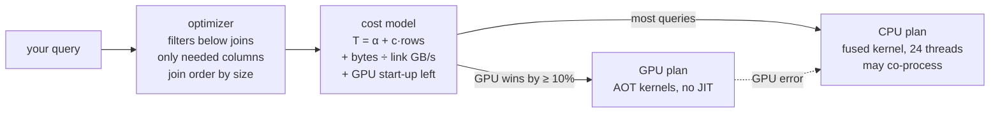
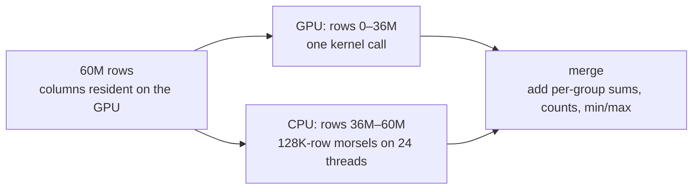

# How `device="auto"` works

MXFrame can run a query on the CPU, on the GPU, or on both at once. With
`compute(device="auto")` the engine decides, per query, from numbers it measured on
your machine. This page explains the algorithm we built during the auto-mode
work and the measurements that shaped it.

**Interactive version:** [How device="auto" decides](https://abhisheksreesaila.github.io/mxframe/auto-mode.html) on the docs site (the rules with live inputs, and the measured results).

> **Status:** the measurements on this page are from 2026-10-12, before the native Mojo
> executor. Since F-053, a CPU decision under `device="auto"` runs the native executor exactly as
> `device="cpu"` does. Since F-057 a split is chosen only when (1) the split path can take the plan
> (`pipeline_exec.split_check`, the same checks that path runs), (2) the query's columns are already
> resident on the GPU (the first query runs native and queues the upload; a file's residency is keyed by
> the file's identity, so each `scan_parquet` compute finds it), and (3) the calibrated price beats the faster
> device alone by 10% after the GPU's 4.5 ms per call, the merge and a 5% CPU-contention allowance
> (`coproc_fused.plan_split`; `explain` prints the numbers). The CPU share of a split runs on the native
> executor. The model prices the native executor as equal to the older kernel
> (`auto_mode.NATIVE_CPU_FACTOR = 1.0`). The numbers below have not been re-run; re-measuring auto on a
> quiet machine is the open item of F-053 and F-057 in [plan.md](plan.md).
> A file's residency is keyed by its identity (path, inode, mtime, size): a file rewritten in place with the same size within one mtime tick (coarse-mtime filesystems) can be served from the old GPU copy.

All numbers below come from the reference machine: AMD Ryzen 9 5900X (24 threads,
dual-channel DDR4) and an NVIDIA RTX 3090 on PCIe 4.0 x8, TPC-H data at scale factor 10.

## The short version

- **Not what it does:** stream every query's rows through one shared queue to the CPU
  and the GPU at once. That scheduler exists and is tested (`coproc.run_router`), but on
  this hardware it lost: moving rows from host memory over the PCIe link is slower
  than all CPU cores reading them in place.
- **What it does:** picks the cheaper device for each query from measured costs, runs a
  table's first scan on the CPU, copies that table's columns to the GPU in the
  background, and on later queries splits the rows: the GPU takes the slice it already
  holds while every CPU core takes the rest, at the same time.

## 1. Every query: plan, price, place

- Costs come from `mx.calibrate()`: a fit of time against rows for every kernel on
  each device, the link bandwidth, and the GPU's start-up time. Every run refines the fits.
- Inputs under 200K rows go straight to the CPU; the GPU's fixed costs can't pay off there.
- A GPU error reruns the query on the CPU. A CUDA fault switches the GPU off for the rest
  of the process. A GPU path that hasn't been verified against DuckDB is never chosen.

## 2. One session: how the GPU gets involved

The GPU pays off once the data already lives there. So:

1. **First query on a table:** runs on the CPU. Once no query has run for 0.1 s, the
   table's columns are copied to the GPU in the background, and the GPU starts up. A script
   that runs several queries back to back therefore finishes them before any GPU work
   competes for its cores. The copy also pauses while any other query runs.
2. **Second query:** splits the rows between the devices, paying the GPU's one-time
   warm-up.
3. **Later queries:** split the rows with no copy over the link at all.

| Run (SF10 Q1, one session) | 1 | 2 | 3 and later |
|---|---:|---:|---:|
| CPU only | 177 ms | 58 ms | 58–65 ms |
| `auto` | 185 ms | 71–73 ms | **43–49 ms** |

## 3. The split: one slice each, then merge

An aggregation reads each row once and keeps a running total per group, so any slice
of rows can run on either device and the totals simply add up. Auto mode picks the
GPU's share so both devices finish together, starting from the calibration and
refining it from each run's measured times.

## 4. Why this design, in numbers

The fused aggregation stage of SF10 Q1 (60M rows):

| Strategy | Time |
|---|---:|
| CPU only, 24 threads | 57 ms |
| GPU only, data in host memory | 353 ms |
| Morsel queue streaming host → GPU | 67–160 ms |
| GPU only, data resident on the GPU | 39 ms |
| Morsel queue, data resident | 42 ms |
| **Static split, data resident** | **25 ms** |

- **The link is the bottleneck.** Host memory feeds the CPU cores at roughly 40–50 GB/s;
  the GPU's PCIe 4.0 x8 link carries about 10–13 GB/s.
- **Once columns are resident, splitting beats both devices:** 25 ms against 57 on the
  CPU and 39 on the GPU.
- **One call per device beats many small GPU morsels.** Each GPU call costs about 4.5 ms
  of fixed overhead, so one static slice wins over a dynamic queue.

## What's not in auto mode yet

- **Joins on the GPU.** Joins run on the CPU through the join engine; placing large joins on
  the GPU is planned.
- **Streaming co-processing for first scans.** Not worth it on PCIe x8. It becomes
  interesting on PCIe 5 or unified-memory machines (Grace Hopper, Apple silicon), where
  the scheduler already exists.
- **A native Parquet reader.** Reading uses PyArrow for now; on raw scans that is the
  largest remaining gap to Polars.

The full design, with the research it draws on, is in
[docs/spec-auto-mode.md](spec-auto-mode.md).
