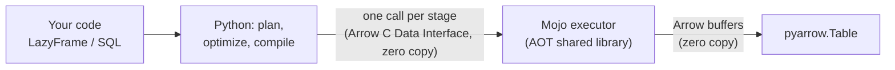
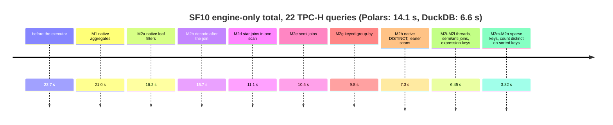
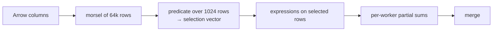
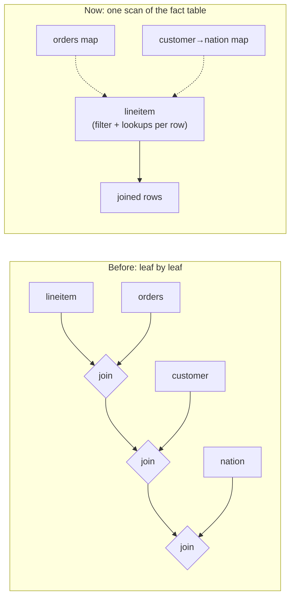
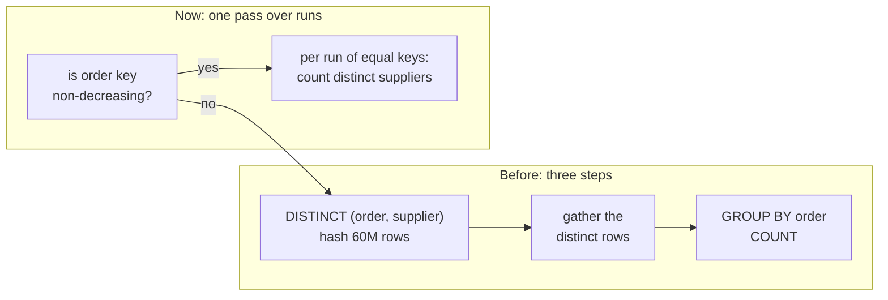
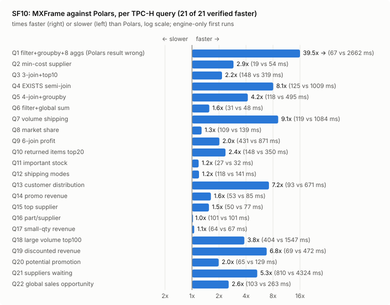
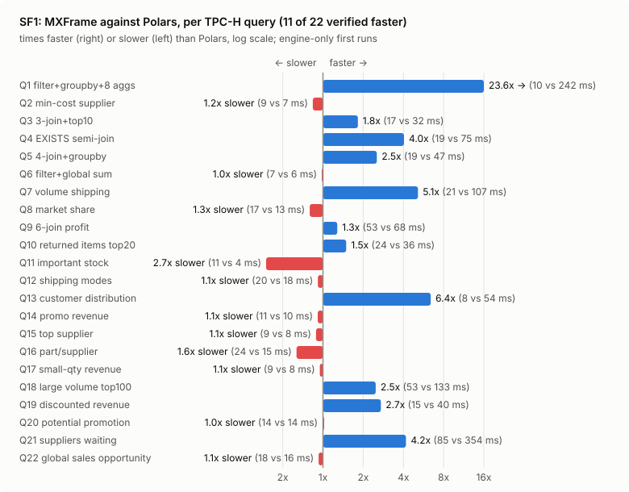

# How MXFrame got fast

This page tells the story of MXFrame's CPU engine, one optimization at a time: what was slow, why,
what the engine does now, and what it bought. Every number comes from the engine-only TPC-H
benchmark in [`docs/bench/`](bench/):

- each query runs in a fresh Python process, with no warm-up;
- the data is already loaded into memory;
- the clock covers only the query and its materialized result;
- every result is checked against DuckDB.

It is also an argument: that **Mojo** is a good language for building a data engine. Each
section says which Mojo feature the optimization relies on, or says plainly when the win is
ordinary engineering that any language would get.

> Numbers: [`docs/bench/m2n-engine.md`](bench/m2n-engine.md) (2026-10-13, mx-cpu, Polars and
> DuckDB in one run; Ryzen 9 5900X, 12 cores). Charts: `pixi run python scripts/plot_progress.py`.

## The shape of the engine

The split was agreed at the start of the work. **Python is a thin front end:** it parses,
plans, optimizes, and turns expressions into a small bytecode. **All the work that loops over
rows is done by Mojo:** filters, joins, group-bys, DISTINCT and gathers. Python hands Mojo
pointers to the Arrow buffers; Mojo reads them in place and writes its results into one block of
memory. Arrow then wraps that block without copying it.

### The Mojo features this relies on

| Feature | Where it is used |
|---|---|
| **Ahead-of-time shared libraries** (`mojo build --emit shared-lib`, `@export ... abi("C")`) | `libmxexec_cpu.so`, called from Python through `ctypes`: no JIT warm-up inside a query |
| **`parallelize` with capturing closures** | every pass is a closure over its inputs, run on all cores in a few lines (morsel-driven, work-stealing through an atomic counter) |
| **Compile-time parameters** (`def f[E: ..., keyed: Bool]`, `comptime if`) | one interpreter body compiled into specialized versions (with and without per-block group keys); the key encoder closure is inlined, no virtual call per row |
| **`SIMD[DType.float64, W]` with `W = simd_width_of[...]()`** | aggregation lanes and vector loads sized for the CPU it was compiled for (AVX2: 4 doubles) |
| **Systems-level control from a Python-like language** | raw pointers into Arrow buffers, `madvise` for huge pages, `calloc` for lazily zeroed lookup arrays |

## The milestones

### M0 / M1: one native call runs a whole aggregate

**Before:** each operator was a separate kernel launch with Python glue between them, and
intermediate results were copied back and forth.

**Now:** the whole `Filter → GroupBy → Aggregate → Sort/Limit/Having` pipeline is compiled into
bytecode (registers, constants, a predicate section, a body section, aggregate slots). The data
is read once, in 64k-row morsels. One Mojo interpreter evaluates the bytecode over 1,024 rows at
a time, with SIMD, on every core.

*Mojo:* `parallelize` over morsels and `SIMD` lanes in the accumulators.

### M2a / M2b / M2c: joins stop paying for strings and for Python

- **Native leaf filters (M2a).** Each table under a join is filtered in Mojo. Only the surviving
  rows of the columns the join needs are written out. Q19 at SF10: 2,159 → 146 ms.
- **Decode strings after the join (M2b).** A dictionary-encoded string column (for example
  `p_type`, with only 150 distinct values) stays encoded until the join has decided which rows
  survive. Q12 at SF10: 1,788 → 511 ms.
- **Native gather (M2c).** The join's final "take these rows" is one Mojo call instead of Arrow
  `take`.

### M2d: star joins in one scan

**Before:** every join was materialized one at a time: filter lineitem, join it to orders,
join that to customer, and so on.

**Now:** the largest table (the *fact* table) is scanned once. Every other table is turned into
a lookup map on its join key. While the fact table's filter runs, each surviving row looks up its
partners and only fully joined rows are written:

- **compact key ranges** use a direct array indexed by key;
- **sparse keys** use a hash table split into 64 partitions, built in parallel.

SF10: Q3 674 → 265 ms, Q9 1,496 → 667 ms, Q18 1,980 → 825 ms. The total went from 15.9 s to
11.1 s.

### M2e: semi joins without the DISTINCT

A partner that is `DISTINCT(keys)` and is joined on exactly those keys (Q4: "orders that have a
late lineitem") only has to answer one question: does a match exist? The DISTINCT never runs.
Q4 at SF10: 966 → 259 ms.

### M2f: not importing `pyarrow.compute` (plain engineering)

Importing `pyarrow.compute` costs about 22 ms per process: it generates a docstring for each of
its roughly 270 functions. Arrow's own methods, such as `Array.cast` and `Table.filter`, import
it as a side effect, so 15 of the 22 queries paid that cost inside their first run.

MXFrame now calls Arrow's compute core directly. At SF1: Q17 41 → 17 ms, Q11 32 → 13 ms. **Not a
Mojo win**, but it shows that at small scale, fixed costs matter as much as kernels do.

### M2g: a group-by specialized at compile time

**Before:** a group-by with more than 4,096 groups first wrote a group id for every row of the
table (60M rows at SF10), including rows the filter was about to drop, and then aggregated in a
second pass.

**Now:** group ids are computed per 1,024-row block, only for the rows that pass the filter, and
are folded straight into per-worker partial sums.

*Mojo:* the interpreter is written once as `_pipeline[E, keyed: Bool]`. The compiler emits one
version that reads a precomputed group-id array and one that calls the key encoder `E`, a closure
inlined into the row loop. Two specialized loops from one source, with no runtime dispatch. Q15's
100k-group view at SF10: 158 → 63 ms.

### M2h: native DISTINCT, nested stars, leaner scans

- **DISTINCT in Mojo.**
  1. Row tuples are hashed in parallel.
  2. A small per-block cache drops repeats early, so 25 distinct values don't all land on one
     thread.
  3. The remaining rows are spread over 64 partitions, keeping row order.
  4. Each partition keeps the first row of each tuple, which preserves first-appearance order
     exactly.

  Q16's DISTINCT went from 112 to 24 ms. On 3M rows with 4 columns it takes 74 ms; the
  first-attempt group-by route took 1,638 ms.
- **Nested star joins.** A partner that is itself a chain of tables (Q8's orders → customer →
  nation) becomes its own star scan.
- **Most selective lookup first**, a presence **bitmap** in front of each direct lookup array
  (one bit per key, small enough for L2 cache), and **kept-row lists** instead of a 60M-entry row
  mask. Q8 at SF10: 212 → about 100 ms.

The total went from 9.8 s to 7.3 s; **the engine beat Polars on 20 of the 22 queries at SF10.**

### M2i: fewer threads can be faster

With 1.5M groups, each of the 24 workers was zeroing and later merging its own 24 MB partial
table, 576 MB of memory traffic for 6M input rows. Capping the partial budget at 128 MB, and
the workers at rows / groups, makes Q18 at SF1 go from 164 to 84 ms (Polars: 134 ms). Plain
engineering: more parallelism isn't free.

### M2j: semi and anti joins in the API

`join(..., how="semi" | "anti")` and `col(...).str_slice(offset, length)` let TPC-H Q22
("customers who never ordered") be written in MXFrame alone instead of dropping to PyArrow. SF1:
34 → 18 ms.

### M2k: one thread per core, not per hyperthread (plain engineering)

The machine has 12 cores and 24 hardware threads. These kernels are limited by memory bandwidth,
so the second hyperthread on a core only adds contention. Using one worker per physical core,
and fewer for small inputs (one per 128k rows), helped at both scales: SF10 Q21 3.78 → 3.54 s,
SF1 Q8 22 → 19 ms.

### M2l: grouping by a computed key

TPC-H's "order year" is computed from a date with a CASE WHEN. Grouping by it used to push the
whole aggregate back to Python and Arrow. Now:

1. One native min/max pass measures the key's range.
2. The key expression is compiled into the same bytecode program as a hidden aggregate slot.
3. The group-by reads that slot's register straight from the interpreter, per block.

*Mojo:* the key encoder is a closure that receives the interpreter's registers, and the compiler
inlines it into the specialized row loop. SF10 Q9 666 → 439 ms (Polars 930 ms).

### M2m: small inputs over wide key ranges

Profiling the SF1 losses showed that Python planning is only 2-3 ms per query. The real cost was
the group-by kernel. Q11 groups about 32k rows by part key, whose range is 200k. Every worker
zeroed and merged a partial table sized for all 200k keys (about 13 MB), and then computed key
codes for every one of them.

Now a key range of at least 16,384 that is more than twice the row count takes the compacted path:
only the keys that occur are numbered, still in key order. Key codes are computed only for groups
that survive. SF1 first runs, measured in-process right after the change: Q11 14.6 → 6.1 ms,
Q17 29.5 → 9.7 ms, Q2 15.7 → 9.3 ms (in the benchmark run below, Q11 took 10.9 ms: small queries
move by several ms from run to run). Plain
engineering: the work should be proportional to the data, not the key range.

### M2n: COUNT(DISTINCT) on sorted keys (F-023)

TPC-H Q21 asks, per order, how many different suppliers delivered it (and how many were late). It
was written as `select(order, supplier).distinct().groupby(order).count()`: a 60M-row DISTINCT,
then a gather of the distinct table, then a second group-by. That was 2.5 s of Q21's 3.4 s at SF10.

But lineitem is stored by order key, and a filter keeps that order. When a key never decreases,
equal keys sit next to each other in **runs**, and each run is one group. So the engine checks the
order (one cheap pass), then counts the distinct suppliers inside each run, a handful of rows,
in one parallel pass. No hash table over 60M rows, no distinct table, no second group-by.

SF10 Q21: 3.44 s before (M2l run) → 0.95 s (Polars 3.93 s, DuckDB 2.81 s in the same run as the 0.95). SF1: 279 → 102 ms. Polars and DuckDB use
the same idea when they know a column is sorted; MXFrame checks at run time.

*Mojo:* the kernel is a few `parallelize` closures over blocks that start at run boundaries, and
reuses the value hashing and comparison helpers written for DISTINCT, including strings.

## Where it stands

| total of 22 queries | MXFrame (CPU) | Polars | DuckDB |
|---|---:|---:|---:|
| SF10, engine-only | **3.82 s** | 14.12 s | 6.57 s |
| SF1, engine-only | **0.52 s** | 1.33 s | 2.20 s |

- **Against Polars:** faster on all 21 verified queries at SF10 (the closest is Q16, 95 ms vs
  100 ms; Polars' Q1 result is wrong, see below) and on 15 of 22 at SF1.
- **Against DuckDB:** faster on 18 of 22 at SF10 (DuckDB wins Q4, Q10, Q18 and Q22) and on all 22
  at SF1.
- All 44 results equal DuckDB's.

### Read these numbers honestly

- **Engine-only is the headline.** Loading data is staging and stays outside the clock (as in the
  TPC-H power test, the H2O db-benchmark and ClickBench); the clock covers the first run of the
  query in a fresh process. The secondary user-felt scoreboard (import and Parquet read included,
  `docs/benchmarks.md`) has not been re-run since these optimizations. MXFrame still reads
  Parquet through PyArrow, so that gap remains (F-021).
- **MXFrame's kernel warm-up is staged.** `import mxframe` warms the kernel libraries in a
  background thread that finishes during the untimed load; Polars and DuckDB have no such step.
- **Polars' Q1 is an outlier.** At SF10 its first run takes 2.6 s, and its result differs from
  DuckDB's (float32 accumulation). Leaving Q1 out, SF10 totals are MXFrame 3.75 s, Polars 11.54 s,
  DuckDB 6.35 s.
- **SF1 losses are small.** MXFrame still loses 7 queries at SF1 (Q8, Q11, Q14, Q15, Q16, Q17,
  Q22), each by 1-7 ms. Python planning is about 2-3 ms of each; the rest is per-call cost of
  native calls on small inputs. These numbers move by a few ms from run to run.
- **The machine was shared.** Other jobs were running during the run (median load average 4.4).
  A quiet-machine rerun (F-009's protocol) is still to do before any
  published claim.
- **Some wins are not Mojo.** M2f (imports), M2i (fewer workers) and M2k (physical cores) are
  ordinary engineering. The Mojo-specific part is everything that runs per row: the interpreter,
  the lookups, the hash tables, the gathers, DISTINCT and the run-based count, compiled ahead of
  time from code that reads like Python. M2m (work proportional to the data) is engineering too.
