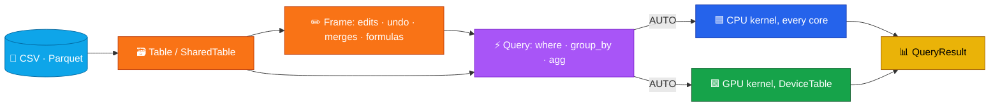

# omxcore: the APIs, the latest release, install

The details behind the [README](../README.md). Every Python code sample and every API-table example on this page is run
by `tests/test_readme_api.py`; the Mojo example by `scripts/mojo_test.sh`. The story, the design choices and why
omxcore is built for agents: [the story page](https://abhisheksreesaila.github.io/omxcore/story.html).

## Two ways in

| | 🐍 **Python package** (`pip install mxframe`, then `import omxcore as mx`) | 🔥 **Mojo API** (`from omxcore import ...`) |
|---|---|---|
| For | notebooks, pipelines, SQL | apps and agents compiled in Mojo, e.g. [omxplorer](https://github.com/abhisheksreesaila/mxapp) |
| Python | Arrow in, Arrow out | **none**: no libpython, links on Linux and macOS (arm64) |
| Devices | 🟦 CPU · 🟩 GPU · 🟪 auto (a cost model calibrated on your machine) | 🟦 CPU · 🟩 GPU · 🟪 AUTO (GPU when a device copy is attached, CPU fallback with its reason) |
| Bigger than memory | 💾 streams files, spills big joins to disk (Grace hash join) | 💾 streams Parquet a row group at a time: a 1.6 GB file in 72 MB, with edits and save over it |
| Data | Parquet, Arrow, SQL | CSV (parallel, typed, import report), Parquet (zstd / snappy), edits, undo, formulas |




```mojo
from omxcore import read_csv, CsvOptions, Query, Frame, col, sum, count, AUTO

var csv = read_csv("orders.csv", CsvOptions())       # parallel, typed, with an import report
var orders = csv.take_table().share()
var region = orders.column("region")
var out = (Query(orders).where(col("qty") > 2)
           .group_by(col("region"), groups=len(orders.dictionary(region)))
           .agg(sum(col("revenue")), count()).compute(AUTO))      # out.device: where it ran
var f = Frame(orders)                                 # a session's edits over shared data, no copy
f.set_text(f.column("revenue"), 0, "99.00"); f.formula("net = revenue - qty")
print(Query(f).agg(sum(col("net"))).compute().values(0)[0])     # decimals are exact scaled integers
```

Runnable as [`mojo/tools/readme_example.mojo`](https://github.com/abhisheksreesaila/omxcore/blob/main/mojo/tools/readme_example.mojo) (checked by `pixi run mojo-test`). Reference: [Mojo API](https://github.com/abhisheksreesaila/omxcore/blob/main/docs/omxcore-mojo-api.md) · [build switches](https://github.com/abhisheksreesaila/omxcore/blob/main/mojo/README.md) · build the package with `pixi run bash scripts/build_mojo_pkg.sh` → `build/omxcore.mojoc`.

## Latest release: 0.6.0

The native Mojo CPU executor ([release notes](https://github.com/abhisheksreesaila/omxcore/blob/main/RELEASE_NOTES_0.6.0.md)). All 22 TPC-H queries, query time only (fresh process, data already loaded, no warm-up), every omxcore result equal to DuckDB's:

| Run | omxcore | DuckDB | Polars |
|---|---|---|---|
| SF10 | 3.15 s | 5.08 s | 14.40 s |
| SF1 | 0.47 s | 0.63 s | 1.31 s |
| SF10 shuffled | 4.97 s | 5.55 s | 15.06 s |
| SF1 shuffled | 0.61 s | 0.66 s | 1.41 s |

Honestly: Q21 carries the lead. Without it DuckDB is ahead, 2.27 s to 2.41 s at SF10 and 2.79 s to 3.63 s at SF10 shuffled, and DuckDB is faster on 12 of the 22 SF10 queries, mostly join-heavy ones. On seeded random queries over the same tables (geometric mean of DuckDB's time over omxcore's), omxcore is 1.09x at SF10 (50 queries), 0.83x at SF1 (100) and 1.21x at SF1 shuffled (100). [Every query, interactively →](https://abhisheksreesaila.github.io/omxcore/benchmarks.html)

## Install and run

```sh
pip install "mxframe[runtime,sql]"   # pixi: pixi add --pypi "mxframe[sql]" (MAX comes from conda)
# 0.6.0 on PyPI imports as `mxframe`; from source (and the next release) both `omxcore` and `mxframe` work
```

```python
import omxcore as mx

lf = mx.scan_parquet("lineitem.parquet")
out = (lf.filter(mx.col("l_quantity") < 24).groupby("l_returnflag")
         .agg(mx.col("l_extendedprice").sum().alias("revenue"))
         .sort("l_returnflag").compute(device="cpu"))   # a pyarrow Table
print(out.to_pandas())
```

Nothing runs until `.compute()`; then the plan is optimized and executed in one native call. The 0.6.0 numbers above are `device="cpu"`; the default, `device="auto"`, runs the same native executor whenever it decides on the CPU, and `explain(device="auto", costs=True)` says why. On main (F-058, quiet machine) auto took 2.75 s against cpu 2.67 s on all of SF10. Extras: `runtime` (the MAX engine; pixi users get it from conda), `sql` (sqlglot), `polars`. The GPU path is validated on NVIDIA; omxcore caps the Mojo runtime's GPU memory pool at 25% on import (`MODULAR_DEVICE_CONTEXT_MEMORY_MANAGER_SIZE_PERCENT`).

## API reference

Examples use `lf` (a `LazyFrame` over columns `id, dept, x, price, name, day`) and `lf2` (`id, region`). Every example below is run by `tests/test_readme_api.py`.

**Sources and running**

| Call | What it does | Example |
|---|---|---|
| `mx.scan_parquet(path)` | Lazy Parquet scan (file or directory) | `mx.scan_parquet("t.parquet")` |
| `mx.LazyFrame(table)` | Wrap a `pyarrow.Table` | `mx.LazyFrame(t)` |
| `mx.sql(query, **tables)` | SQL over named tables | `mx.sql("SELECT dept, SUM(x) AS s FROM t GROUP BY dept", t=t)` |
| `.compute(device)` | Run: `"auto"` (default), `"cpu"`, `"gpu"` | `lf.compute(device="cpu")` |
| `.explain()` | The optimized plan, as text | `lf.filter(col("x") > 2).explain()` |

**LazyFrame**

| Method | What it does | Example |
|---|---|---|
| `.filter(expr)` | Keep rows where `expr` is true | `lf.filter(col("x") > 10)` |
| `.select(*cols)` | Pick or compute columns | `lf.select("id", (col("price") * 2).alias("p2"))` |
| `.with_columns(*exprs)` | Add or replace columns | `lf.with_columns((col("x") + 1).alias("x1"))` |
| `.groupby(*keys).agg(*aggs)` | Grouped aggregation | `lf.groupby("dept").agg(col("price").sum().alias("s"))` |
| `.join(other, on, how)` | `how`: inner, left, semi, anti | `lf.join(lf2, on="id", how="left")` |
| `.sort(*by, descending)` | Order rows | `lf.sort("price", descending=True)` |
| `.limit(n)` / `.head(n)` | First n rows | `lf.sort("x").limit(2)` |
| `.distinct(*subset)` | Unique rows | `lf.select("dept").distinct()` |
| COUNT(DISTINCT b) per a | distinct, then count | `lf.select("dept", "x").distinct().groupby("dept").agg(col("x").count().alias("n"))` |
| `.to_pandas()` / `.to_polars()` | Run and convert | `lf.to_pandas()` |

**Expressions**

| Expression | What it does | Example |
|---|---|---|
| `col(name)`, `lit(v)` | A column, a constant | `col("price") * lit(1.1)` |
| `+ - * /`, `== != < <= > >=` | Arithmetic, comparison | `(col("price") - col("x")) > 0` |
| `& \| ~` | And, or, not | `(col("x") > 2) & ~(col("dept") == "ops")` |
| `.isin(values)` | Membership | `col("dept").isin(["eng", "hr"])` |
| `.between(lo, hi)` | Inclusive range | `col("x").between(2, 15)` |
| `.startswith(s)`, `.contains(s)` | String predicates | `col("name").startswith("al")` |
| `.str_slice(offset, length)` | Substring | `col("name").str_slice(0, 2)` |
| `.year()` | Year of a date | `col("day").year()` |
| `when(cond, then, otherwise)` | Conditional (no `otherwise` is NULL) | `when(col("x") > 10, col("price"), 0.0)` |
| `.sum() .mean() .min() .max() .count()` | Aggregates (in `.agg`) | `lf.groupby("dept").agg(col("x").mean().alias("m"))` |
| `.over(*by, order_by)` | Window | `lf.select("id", col("price").sum().over("dept").alias("w"))` |
| `.rank() .dense_rank() .lag(n) .lead(n) .cum_sum()` | Window functions | `lf.select("id", col("price").cum_sum().over("dept", order_by="id").alias("c"))` |
| `.alias(name)` | Name the result | `lf.groupby("dept").agg(col("x").sum().alias("total"))` |

SQL covers `SELECT`, `WHERE`, `GROUP BY`, `ORDER BY`, `LIMIT`, `JOIN … ON` and `CASE WHEN`. Known limits in 0.6.0: SQL `COUNT(DISTINCT …)` isn't supported (use the DataFrame form above), and SQL `HAVING` is dropped without an error.
